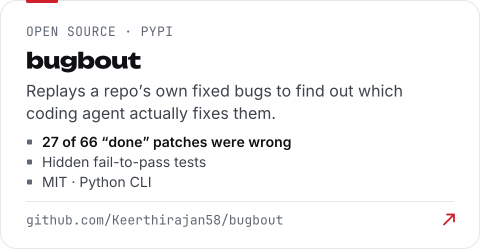
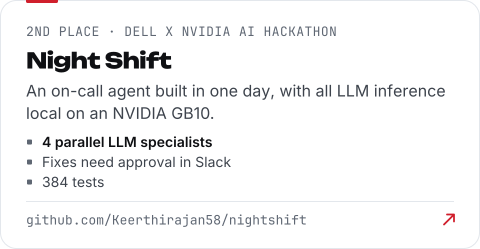
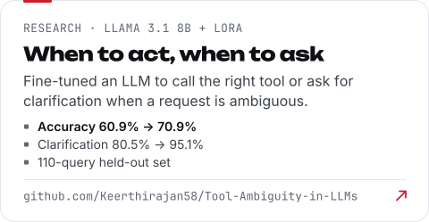
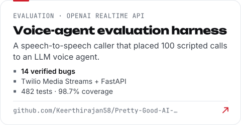
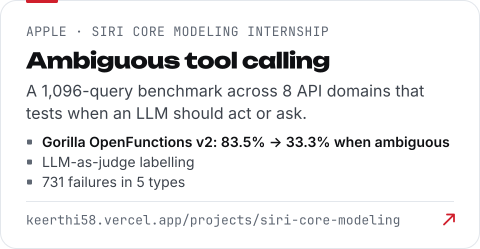
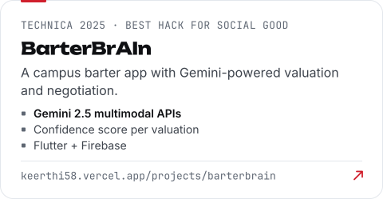
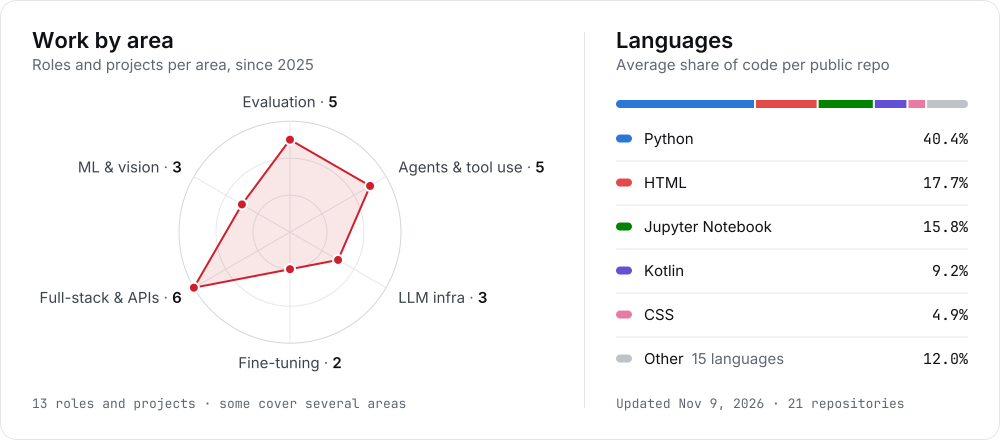

<!-- The images are drawn from data/profile.json by scripts/ (npm run build). The Signals and
     Open source images live on the `output` branch and are redrawn every week by
     .github/workflows/live.yml, which also writes their text version (live.md). -->

<picture>
  <source media="(prefers-color-scheme: dark)" srcset="https://raw.githubusercontent.com/Keerthirajan58/keerthirajan58/main/assets/banner-dark.svg">
  
</picture>
<picture>
  <source media="(prefers-color-scheme: dark)" srcset="https://raw.githubusercontent.com/Keerthirajan58/keerthirajan58/main/assets/typing-dark.svg">
  
</picture>

# Hi there, I'm Keerthirajan 👋

🤖 **AI Engineer at [EventDone](https://www.eventdone.com)**: I deployed a local LLM alongside paid cloud models behind one LiteLLM gateway, with multi-model routing and failover  
🍎 Previously an **AIML Machine Learning Engineer Intern at Apple** (Siri Core Modeling), where I built a 1,096-query benchmark for ambiguous tool calls  
🐛 Building **[bugbout](https://github.com/Keerthirajan58/bugbout)**, an open-source CLI on PyPI that finds out which coding agent actually fixes the bugs in your codebase  
🏆 2nd place at the **Dell x NVIDIA AI Hackathon** (Night Shift) · Best Hack for Social Good at **Technica 2025** (BarterBrAIn)  
🎓 M.S. in Computer Science, The George Washington University (2026)  
🚀 Open to AI/ML and software engineering roles · San Francisco, CA, open to relocate  
📫 Reach me at keerthirajans@gwu.edu or check out my [portfolio](https://keerthi58.vercel.app)

&nbsp;&nbsp;
&nbsp;&nbsp;
&nbsp;&nbsp;
&nbsp;&nbsp;
&nbsp;&nbsp;

## Featured work 🛠️

<a href="https://github.com/Keerthirajan58/bugbout"><picture><source media="(prefers-color-scheme: dark)" srcset="https://raw.githubusercontent.com/Keerthirajan58/keerthirajan58/main/assets/card-bugbout-dark.svg"></picture></a>
<a href="https://github.com/Keerthirajan58/nightshift"><picture><source media="(prefers-color-scheme: dark)" srcset="https://raw.githubusercontent.com/Keerthirajan58/keerthirajan58/main/assets/card-nightshift-dark.svg"></picture></a>
<a href="https://github.com/Keerthirajan58/Tool-Ambiguity-in-LLMs"><picture><source media="(prefers-color-scheme: dark)" srcset="https://raw.githubusercontent.com/Keerthirajan58/keerthirajan58/main/assets/card-tool-ambiguity-dark.svg"></picture></a>
<a href="https://github.com/Keerthirajan58/Pretty-Good-AI-Ai-Engineering-Challenge"><picture><source media="(prefers-color-scheme: dark)" srcset="https://raw.githubusercontent.com/Keerthirajan58/keerthirajan58/main/assets/card-voice-agent-dark.svg"></picture></a>
<a href="https://keerthi58.vercel.app/projects/siri-core-modeling"><picture><source media="(prefers-color-scheme: dark)" srcset="https://raw.githubusercontent.com/Keerthirajan58/keerthirajan58/main/assets/card-siri-dark.svg"></picture></a>
<a href="https://keerthi58.vercel.app/projects/barterbrain"><picture><source media="(prefers-color-scheme: dark)" srcset="https://raw.githubusercontent.com/Keerthirajan58/keerthirajan58/main/assets/card-barterbrain-dark.svg"></picture></a>

## Open source 🌱
<picture>
  <source media="(prefers-color-scheme: dark)" srcset="https://raw.githubusercontent.com/Keerthirajan58/keerthirajan58/output/pulse-dark.svg">
  
</picture>

Pull requests: [nebari-dev/llm-serving-pack#179](https://github.com/nebari-dev/llm-serving-pack/pull/179) · [openteams-ai/collab-hub-pack#79](https://github.com/openteams-ai/collab-hub-pack/pull/79) · [nebari-dev/nebi#567](https://github.com/nebari-dev/nebi/pull/567) · [ShishirPatil/gorilla#1365](https://github.com/ShishirPatil/gorilla/pull/1365) · [nebari-dev/data-science-pack#246](https://github.com/nebari-dev/data-science-pack/pull/246) · [nebari-dev/llm-serving-pack#186](https://github.com/nebari-dev/llm-serving-pack/pull/186)

[Text version of this card](https://github.com/Keerthirajan58/keerthirajan58/blob/output/live.md#open-source)

## Signals 📡
<picture>
  <source media="(prefers-color-scheme: dark)" srcset="https://raw.githubusercontent.com/Keerthirajan58/keerthirajan58/output/signals-dark.svg">
  
</picture>

[Text version of these charts](https://github.com/Keerthirajan58/keerthirajan58/blob/output/live.md#signals)

## What do I know? 📜

Also: SQL&nbsp;· Hugging&nbsp;Face&nbsp;Transformers&nbsp;· LoRA/PEFT&nbsp;· SFT&nbsp;· LangChain&nbsp;· LiteLLM&nbsp;· Ollama&nbsp;· RAG&nbsp;· MCP&nbsp;· OpenAI&nbsp;Realtime&nbsp;API&nbsp;· LLM-as-judge&nbsp;· pytest

<picture>
  <source media="(prefers-color-scheme: dark)" srcset="https://raw.githubusercontent.com/Keerthirajan58/keerthirajan58/main/assets/footer-dark.svg">
  
</picture>
